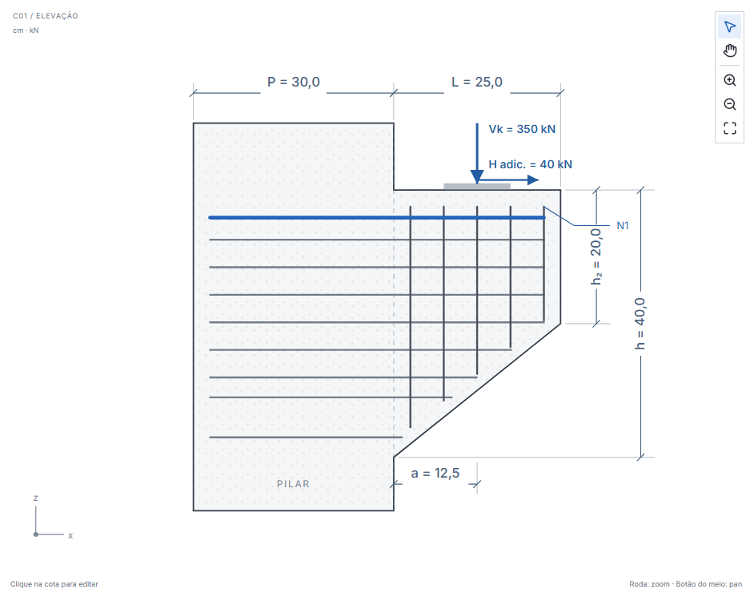
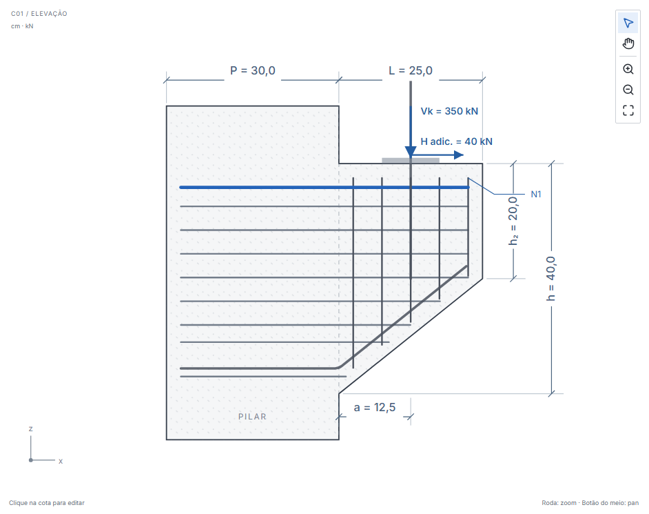
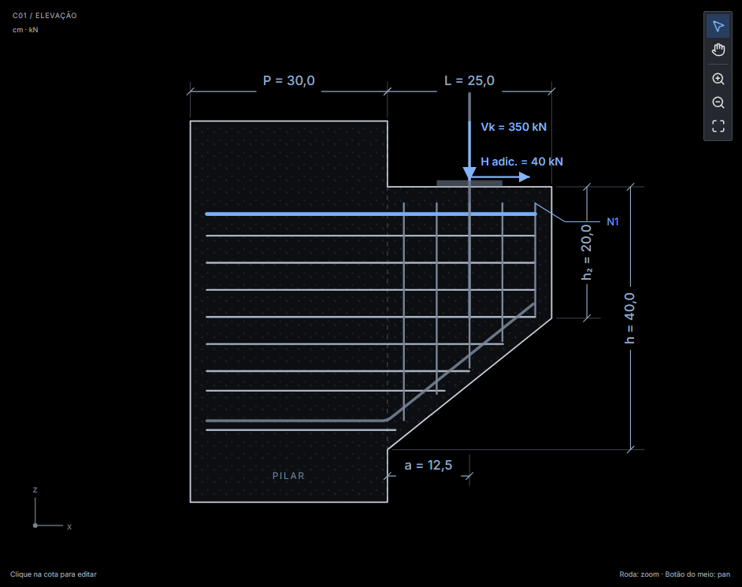
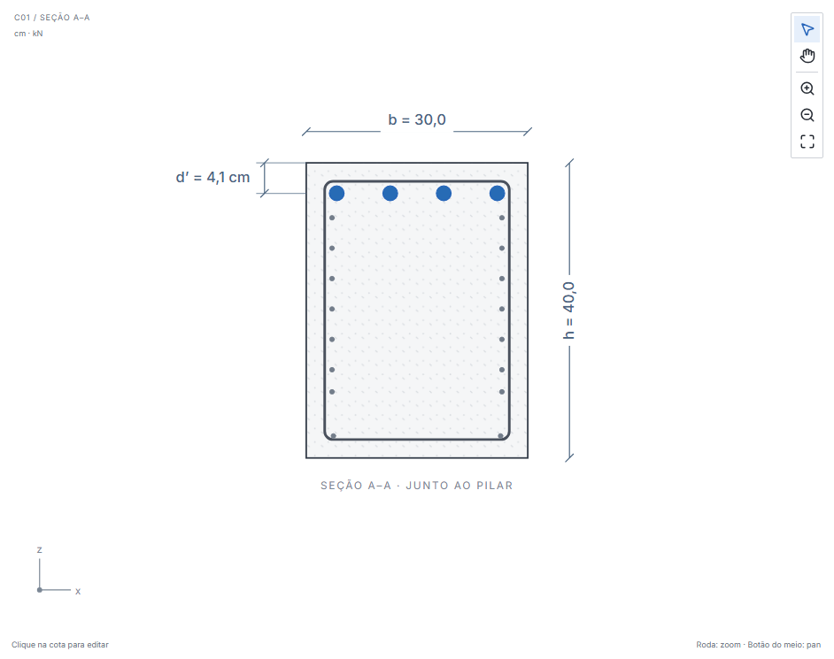
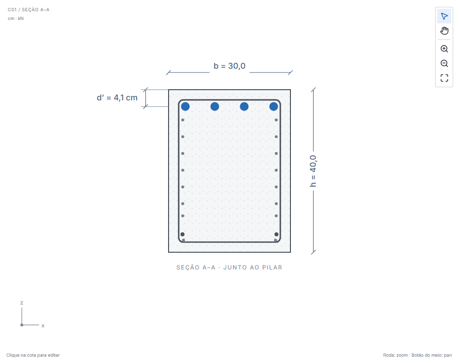
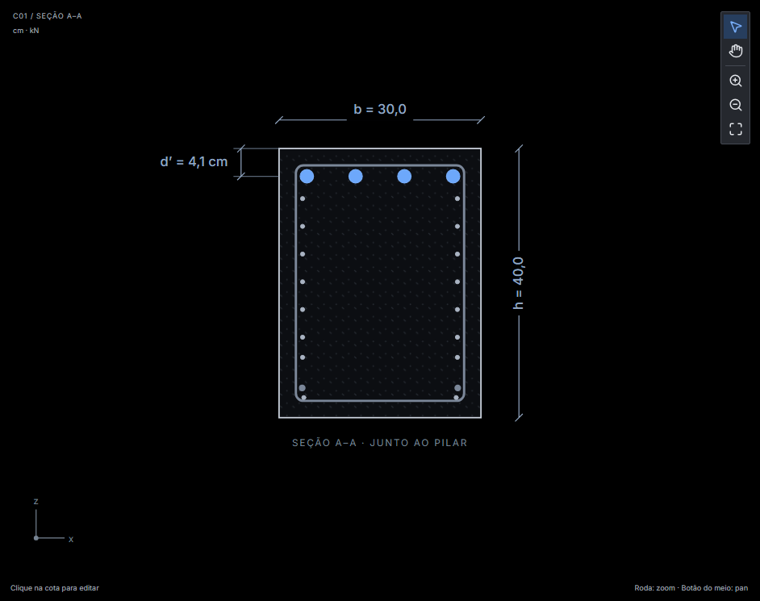

# Validação: famílias de barras nas vistas de modelagem (#36 / #39)

## Integração com a master e N4

O PR original usava a família opcional `mounting`. A master passou ao esquema 5 e substituiu essa família pela N4 construtiva obrigatória. Esta integração preserva a geometria atual de N2/N3/N3G/N4 e a cota d’, sem acrescentar um segundo porta-estribos nem reutilizar a interseção antiga.

O complemento que permanece necessário é a projeção dos pinos de ligação e da barra transversal soldada na elevação. `connections.ts` compartilha as coordenadas físicas com `model.ts`; `projection.ts` produz a representação sem chamar `calculate` ou gerar todo o detalhamento na renderização da elevação.

- Os pinos ficam em `x = a`, da espera negativa ao embutimento positivo. Os eixos transversais se sobrepõem nessa vista ortográfica; uma projeção identifica a marca PINO, a quantidade e a bitola. O espaçamento transversal continua no detalhamento.
- A barra soldada aparece de topo, com diâmetro físico e na profundidade de cada camada ocupada; marcas TS/TS-n iguais às do quadro. Não é criada na alça nem no modo “Armado como viga”, que mantém a positiva P1 separada. A declaração de barra soldada no suporte é outro recurso e não cria esta barra frontal.
- As ligações não são simuladas na seção A–A junto ao suporte. N4 e os planos explicitamente identificados de N3/N3G continuam usando os helpers atuais de `transverse.ts`.
- Nenhuma fórmula de resistência, unidade, resultado, quantitativo, versão de projeto ou formato de exportação foi alterado.

## Verificação da integração

- `npm run check`: 379 testes unitários, incluindo 15 de projeção. Cobrem 1–20 pinos, 1–4 camadas, camadas vazias, ausência de comprimento, consolo/viga, recorte, dois/quatro ramos, marcas, persistência e ausência de cálculo ELU na projeção.
- Comparação direta com `master` 057eec7 em 64 combinações: entradas, barras completas, comprimentos, marcas, massas, pendências, resultados do motor e entidades do desenho de fabricação idênticos.
- `tests/e2e/projection.spec.ts`: cinco cenários reais de Chromium, incluindo ambos os modos, dois/quatro ramos, temas claro/escuro, coordenadas da projeção, N2/N3/N4/d’, visibilidade, salvamento, edição, desfazer/refazer e reabertura. Capturas em `playwright-results`, junto da suíte completa da CI.
- Nesta estação, o teste de interface não iniciou porque o Chromium não estava disponível e seu download retornou arquivo truncado. A verificação de interface é feita no container Playwright da CI; o resultado da execução deve ser conferido no PR.
- Sem alterações nativas Tauri; não foi executado teste nativo de instalação.

Esta entrega complementa #36; não fecha automaticamente sua conferência integral nem altera as decisões de projeção da seção já documentadas na revisão de N3/N3G.

## Capturas históricas do PR original

As imagens abaixo registram o código anterior à N4, no exemplo C01 com porta-estribos inferior e dois pinos. São mantidas como histórico da contribuição original; não representam a integração atual nem validam o contrato atual de N4.

Elevação, antes e depois (tema claro):

Elevação, depois (tema escuro):

Seção A–A, antes e depois (tema claro):

Seção A–A, depois (tema escuro):

## Limites

- A barra transversal soldada só aparece com ancoragem frontal soldada; não há captura dela.
- O desenho de fabricação da aba Detalhamento não mostra o porta-estribos na seção; não foi alterado.
- Sem validação nativa Tauri. Testes aprovados não constituem certificação normativa nem liberação de projeto executivo.
